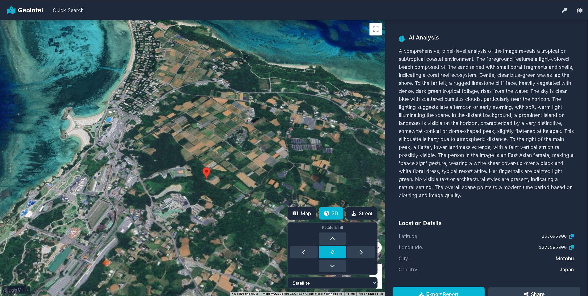

# GeoIntel v3

Python tool that uses Google's Gemini API to work out where a photo was taken, through AI-powered geolocation analysis. It has a command line interface, a web interface, and a Python SDK.



## Features

- AI geolocation of local image files and image URLs
- Web interface with drag-and-drop upload and an interactive **Leaflet + OpenStreetMap** map (no map API key needed)
- Map layers: Street (OSM), Dark, Satellite, Terrain
- Model selection: Gemini 3.8 Flash (default), 3.6 Flash, 3.1 Pro
- Automatic retry and **automatic fallback to another model** when the selected one is overloaded (HTTP 503/429) or times out
- Confidence level (High / Medium / Low) and coordinates for each candidate location
- Optional context and location guess to guide the analysis
- Export results to JSON
- Google Maps link for each result

## Requirements

- Python 3.8 or newer
- A Gemini API key from [Google AI Studio](https://aistudio.google.com/apikey)
- Internet access (to reach the Gemini API and the OpenStreetMap tiles)

## Installation

### Recommended: virtual environment (works on Kali, Debian, Ubuntu and other systems that block global `pip`)

```bash
git clone https://github.com/atiilla/geointel.git
cd geointel

python3 -m venv .venv
source .venv/bin/activate

pip install -e .
```

Check that it works:

```bash
geointel --help
```

Each time you open a new terminal, activate the environment again with `source .venv/bin/activate`.

### Alternative: install from PyPI

```bash
pipx install geointel      # isolated, no virtualenv to manage
# or
pip install geointel
```

### Development install (with tests)

```bash
pip install -e . pytest
python -m pytest -q tests
```

## API key

Get a key from [Google AI Studio](https://aistudio.google.com/apikey), then use one of these:

| Method | How | Notes |
|---|---|---|
| Environment variable | `export GEMINI_API_KEY="your_key"` | Recommended for CLI and SDK |
| Web interface | Click the key icon and paste the key | Kept in browser memory only, so you enter it again after a refresh |
| `--api-key` flag | `geointel --image a.jpg --api-key "your_key"` | Ends up in your shell history; avoid on shared machines |

Never commit your key to git.

## Usage

### Web interface

```bash
geointel --web                                # http://127.0.0.1:5000
geointel --web --host 0.0.0.0 --port 4000     # custom host and port
```

Open `http://127.0.0.1:5000`, set your API key and model with the key icon, then drop an image onto the page.

> Only expose the server with `--host 0.0.0.0` on a network you trust. The server has no login, and the API key is sent with each request.

### Command line

```bash
geointel --image path/to/photo.jpg
```

| Argument | Description |
|---|---|
| `--web` | Launch the web interface (no `--image` needed) |
| `--host` | Host for the web interface (default `127.0.0.1`) |
| `--port` | Port for the web interface (default `5000`) |
| `--image` | Local file path or image URL to analyze (required in CLI mode) |
| `--model` | Model to use: `gemini-3.8-flash` (default), `gemini-3.6-flash`, `gemini-3.1-pro-preview` |
| `--context` | Extra information about the image |
| `--guess` | Your own guess of where it was taken |
| `--output` | Save the result as JSON to this file |
| `--api-key` | Gemini API key (overrides `GEMINI_API_KEY`) |

Examples:

```bash
geointel --image vacation.jpg
geointel --image https://example.com/photo.jpg
geointel --image vacation.jpg --context "Taken in summer 2023"
geointel --image vacation.jpg --guess "Mediterranean coast"
geointel --image vacation.jpg --model gemini-3.1-pro-preview --output result.json
```

### Python SDK

```python
from geointel import GeoIntel

geointel = GeoIntel()            # reads GEMINI_API_KEY, or pass api_key="..."
result = geointel.locate(image_path="image.jpg")

if "error" in result:
    print(f"Error: {result['error']} ({result.get('details')})")
else:
    location = result["locations"][0]
    print(f"{location['city']}, {location['country']} ({location['confidence']})")

    lat = location["coordinates"]["latitude"]
    lng = location["coordinates"]["longitude"]
    print(f"https://www.google.com/maps?q={lat},{lng}")
```

See [`examples/library_usage.py`](examples/library_usage.py) for a longer example.

## Response format

```json
{
  "interpretation": "Summary of what the image shows and the conclusion",
  "locations": [
    {
      "country": "Indonesia",
      "state": "DKI Jakarta",
      "city": "Central Jakarta",
      "confidence": "High",
      "coordinates": { "latitude": -6.2155, "longitude": 106.804 },
      "explanation": "Key evidence for this location"
    }
  ]
}
```

Coordinates are an AI estimate of the area, not an exact point. Treat the pin as approximate.

## Troubleshooting

| Message | Meaning and fix |
|---|---|
| `status 503 ... high demand` | The model is overloaded on Google's side. GeoIntel retries and then falls back to another model. If every model fails, wait a few minutes. |
| `status 404 ... not found` | The model ID is not available for your key. Pick another model with `--model` or in the web interface. |
| `API request timed out` | The model did not answer within 240 seconds. Try `gemini-3.6-flash`, which is usually faster. |
| `status 400/403 ... API key` | The key is invalid or restricted. Create a new key in Google AI Studio. |
| `externally-managed-environment` when running `pip install` | Use the virtual environment steps above. |
| `Port 5000 is in use` | Stop the other process or run `geointel --web --port 5001`. |
| `Refusing to fetch image from non-public address` | Image URLs that point to localhost or private networks are blocked on purpose. Download the file and upload it instead. |

The server prints the real error for every failed request in the terminal where `geointel --web` is running.

## Project layout

```
geointel/               Python package (CLI, API client, parser, web server)
geointel_ui_template/   Web interface (HTML, JS)
examples/               SDK example
tests/                  Unit tests (run without an API key)
```

## Disclaimer

GeoIntel is intended for educational and research purposes only. While it uses AI models to estimate the location of where an image was taken, its predictions are not guaranteed to be accurate. Do not use this tool for surveillance, stalking, law enforcement, or any activity that may infringe on personal privacy, violate laws, or cause harm. Only analyze images you own or have permission to analyze.

The author(s) and contributors are not responsible for any damages, legal issues, or consequences resulting from the use or misuse of this software. Use at your own risk and discretion.

Always comply with local, national, and international laws and regulations when using AI-based tools.

## Contributing

1. Fork the repository
2. Create a branch (`git checkout -b feature/new-feature`)
3. Commit your changes (`git commit -am 'Add new feature'`)
4. Push the branch (`git push origin feature/new-feature`)
5. Open a pull request

## License

MIT License. See the [LICENSE](LICENSE) file.


